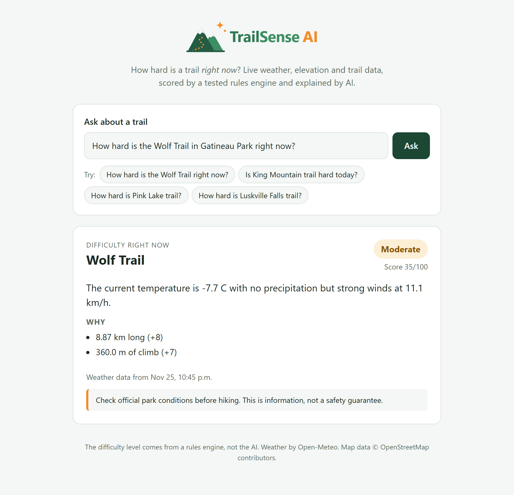
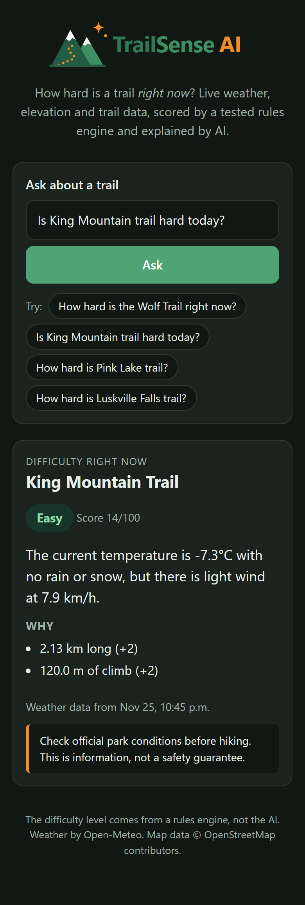

<div align="center">
  
  <p><strong>Ask about a trail. Tools fetch the facts, the rules engine decides, the AI explains.</strong></p>

  
  
  
  
</div>

## About

A small FastAPI service where you ask about a hiking trail in plain English, like *"How hard is the Wolf Trail in Gatineau Park right now?"*. A local LLM calls my tools to get live weather, trail info and elevation, and my own rules engine decides the difficulty. The LLM only collects the data and explains the result.

> **Check official park conditions before hiking.** This app gives information, not safety guarantees.

<table>
  <tr>
    <td width="68%"></td>
    <td width="32%"></td>
  </tr>
  <tr>
    <td align="center"><sub>Desktop: live weather, the engine's level and score, the AI's explanation</sub></td>
    <td align="center"><sub>Phone, dark mode</sub></td>
  </tr>
</table>

## Features

- **Web page** at `/` for normal people: ask a question or tap an example, see a loading counter while the AI works, then a result card with the level colour-coded, the summary, reasons, warnings, gear tips and the data time. Friendly messages when something fails, works on a phone and in dark mode. TypeScript + HTML + CSS, no framework
- `POST /explain`: ask a question in plain English, get a structured JSON answer (level, score, summary, reasons, warnings, gear tips, data time). The AI writes the words; **the rules engine decides the level and score**, and overrides the AI if they disagree
- **Structured output**: the AI must reply with JSON matching a Pydantic schema (Ollama's `format` option), validated and retried once if invalid. If the AI forgets to ask for the difficulty score, the app asks for it itself
- `GET /health` health check, auto-generated API docs at `/docs`
- **Difficulty rules engine**: scores a trail 0–100 from its length, climb, OSM difficulty tag and the next hours of weather (rain, ice, wind, heat). A thunderstorm makes it *Dangerous* whatever the score, and missing data gives *Unknown*, never *Easy*
- `GET /difficulty?trail_id=wolf-trail`: the engine's answer for a trail right now (no AI)
- **LLM tool calling**: the model asks for `find_trail`, `get_weather`, `get_elevation_gain` and `get_difficulty_score` and chains them on its own (e.g. finds the trail, then uses its id). Tool errors go back to the model as messages, never crashes, and a step limit stops runaway loops
- **Swappable AI interface**: the app talks to one `LLMClient` shape; `LLM_PROVIDER` picks the model behind it. Runs locally on Ollama (`qwen3.5:9b`) for free
- **Trail search** in OpenStreetMap: groups a trail's many path segments into one trail, adds up the length, and keeps the hardest difficulty tag
- **Local fallback** of real Gatineau Park trails, used automatically when Overpass is slow or down
- **Live weather** for the trailhead: now, the past 6 hours (for ice) and the next 6 hours
- **Elevation gain** along the trail, with requests batched and run in parallel
- Settings come from `.env` (LLM provider, model, API URLs, timeouts)

## Run it locally

You need [uv](https://docs.astral.sh/uv/). It installs the right Python (3.12) for this project.

```powershell
git clone https://github.com/PranavTiwari44/trailsense-ai.git
cd trailsense-ai
cp .env.example .env
uv sync
uv run uvicorn app.main:app --reload
```

Then open [localhost:8000](http://localhost:8000) for the web page (needs [Ollama](https://ollama.com) running with `qwen3.5:9b`), or [localhost:8000/docs](http://localhost:8000/docs) for the API and try `POST /explain` with `{"question": "How hard is the Wolf Trail in Gatineau Park right now?"}` (needs Ollama running; takes 5–60 s).

The compiled page script (`web/dist/app.js`) is committed, so you only need Node if you change `web/src/app.ts`:

```powershell
cd web
npm install
npm run build    # or: npm run watch, to rebuild on every save
```

Run the tests with `uv run pytest` (94 tests, about a second). The AI is replaced by a scripted fake client, so the tests need no model, no internet and cost nothing. They cover the tool loop, the retry on invalid JSON, the engine overriding the AI's level, and the safety net when the AI skips the difficulty tool.

Try the data services against the real APIs:

```powershell
uv run python -m scripts.try_services "Wolf Trail"
```

Ask the local model a question and watch it use the tools (needs Ollama running):

```powershell
uv run python -m scripts.try_agent "How hard is the Wolf Trail in Gatineau Park right now?"
```

## Evals: testing the AI's answers

Unit tests check my code with a fake AI. **Evals check the real model's answers.** `evals/scenarios.json` holds 18 fixed situations (sunny easy trail, icy steep trail, thunderstorm, missing weather, trail not found, high wind on a ridge...). The tools return each scenario's fixed data, so every run sees the same facts, and the real rules engine still scores it. Each answer is checked for:

- valid JSON matching the schema
- the right difficulty level (and whether the AI's *own* level agreed with the engine)
- no invented numbers: every number in the summary must appear in the tool data
- must-mention words (e.g. "thunder" in a thunderstorm, "ice" on an icy trail)

```powershell
uv run python -m evals.run_evals            # all scenarios (Ollama must be running)
uv run python -m evals.run_evals hot-day    # just one
```

| Run | Model | Passed | AI agreed with engine | Avg time |
|---|---|---|---|---|
| First run | qwen3.5:9b (local) | 15/18 (83%) | 18/18 | 12.1 s |
| + weather safety net | qwen3.5:9b (local) | 16/18 (89%) | 18/18 | 11.4 s |
| + clearer final-answer prompt | qwen3.5:9b (local) | 16/18 (89%) | 18/18 | 12.9 s |

The first run showed the model skipped `get_weather` in every scenario, so it couldn't mention light rain, snow or cold. Adding a code safety net (fetch the weather if the model didn't) fixed two of the three failures. The second run also caught the model writing "winds exceeding 60 km/h" when the data said 65: the invented-number check working as intended.

The third run (a prompt asking for the weather in the summary and exact numbers) fixed both of those, but two others broke: with the summary focused on weather, the model left out "alpine" on an alpine route and forgot to state the level on another. Same score, different failures. A small model has limited room in one or two sentences, so the next step is a separate `conditions` field for the weather instead of squeezing everything into the summary.

## Data

| Source | Used for | Key needed |
|---|---|---|
| [Open-Meteo](https://open-meteo.com) | Weather forecast and elevation | No |
| [OpenStreetMap](https://www.openstreetmap.org) via [Overpass](https://overpass-api.de) | Trail names, paths and difficulty tags | No |

`app/data/trails_fallback.json` is a snapshot of OpenStreetMap data for a few Gatineau Park trails (Wolf Trail, King Mountain, Luskville Falls, Pink Lake). Rebuild it with `uv run python -m scripts.build_fallback`.

Map data © [OpenStreetMap contributors](https://www.openstreetmap.org/copyright), available under the Open Database License.

## To do

- A separate `conditions` field for the weather, so the summary has room for trail facts (see the third eval run)
- An eval check for invented facts without numbers. Live runs showed the small model sometimes adds things that aren't in the data (a made-up "cold alert", "snow" when there was none, calling 11 km/h wind "strong"), which the current number and keyword checks don't catch
- Optional: run the same evals with Claude and compare
